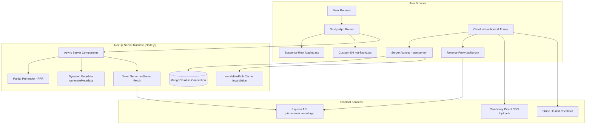

# 🍕 PizzaHub Frontend Client

<div align="center">


**Modern, ultra-fast web application powered by Next.js 16 (App Router + Turbopack), React 19, and Tailwind CSS v4, built for Dhaka, Bangladesh.**

[-black?style=for-the-badge&logo=next.js)](https://nextjs.org/)
[](https://react.dev/)
[](https://tailwindcss.com/)
[](https://www.typescriptlang.org/)
[](https://better-auth.com/)
[](https://sonner.emilkowal.ski/)

[Live Production Site](https://pizzahub-ruddy-gamma.vercel.app) • [Browse Pizza Menu](https://pizzahub-ruddy-gamma.vercel.app/menu) • [Hot Deals](https://pizzahub-ruddy-gamma.vercel.app/deals) • [Sign In (1-Click Demo)](https://pizzahub-ruddy-gamma.vercel.app/sign-in)

</div>

---

## 📖 Table of Contents

- [Client Architecture](#-client-architecture)
- [Key Frontend Features](#-key-frontend-features)
- [Route Inventory (19 Routes)](#-route-inventory-19-routes)
- [Branded Toast Notification System](#-branded-toast-notification-system)
- [FOUC-Proof Day & Night Mood](#-fouc-proof-day--night-mood)
- [API Proxy & Zero-CORS Gateway](#-api-proxy--zero-cors-gateway)
- [Folder Structure](#-folder-structure)
- [Environment Variables](#-environment-variables)
- [Local Development & Scripts](#-local-development--scripts)
- [Vercel Deployment Guide](#-vercel-deployment-guide)

---

## 🏛️ Client Architecture

The PizzaHub client is engineered strictly around modern **Next.js App Router (React Server Component & Server Action)** patterns:



### 1. Server Component First
- Pages like `/`, `/menu`, and `/menu/[id]` are async **React Server Components (RSC)**.
- Data is fetched directly on the server before rendering the initial HTML.
- Visitors receive fully populated pizza cards and recipes on the first byte with zero client-side waterfall delays or `Failed to fetch` errors.

### 2. Partial Prerendering (PPR) & `<Suspense>` Streaming
- Uses Next.js 16 Partial Prerendering to deliver an instant static layout shell while streaming dynamic search params and live kitchen menu items in the background.
- Root `loading.tsx` component provides automatic Suspense-based route transition loading.

### 3. Server Actions for Mutations
- Sensitive and state-altering operations (such as the **VIP Club membership pipeline**) are executed via `'use server'` actions in `src/app/actions/vip.ts`.
- Automatically calls `revalidatePath('/dashboard/admin')` so administrative views update in real time without manual client cache refreshes.

### 4. Dynamic SEO Metadata
- The `/menu/[id]` route utilizes Next.js `generateMetadata` to dynamically inject OpenGraph titles, descriptions, and high-res pizza photography for previews across Google, Twitter/X, and social messengers.

---

## 🍕 Key Frontend Features

### 1. Handcrafted Artisan Menu & Interactive Search (Dhaka, Bangladesh)
- **Instant Search:** Debounced multi-field searching by pizza name, sauce, or topping.
- **Categorization Pills:** `All`, `Classic Pizzas`, `Gourmet Pizzas`, and `Spicy Specials`.
- **Dhaka Location Selector:** Neighborhood-level filtering (`Gulshan`, `Banani`, `Dhanmondi`, `Uttara`, `Mohakhali`, `Mirpur`, `Mohammadpur`, `Baily Road`).
- **Dietary Badges:** 1-click toggles for `🌶️ Spicy Only` and `🍃 Vegetarian Only`.
- **Sorting Options:** Featured & Gold Premium First, Price: Low to High, Price: High to Low.
- **Quick Order Dialog:** Place an order directly from the menu card with delivery address, preferred date, and optional kitchen note.

### 2. Hot Deals & Flash Sale Countdown
- **Live Countdown Timer:** Hours, minutes, and seconds tick down to the next batch of fresh dough.
- **1-Click Promo Vouchers:** Verified discount codes (`HOTCRUST20`, `BOGOPIZZA`, `FREEDROP`, `CHEFSPECIAL`) with copy-to-clipboard functionality and branded toast confirmation.
- **Artisan Combo Bundles:** Visual package cards with savings badges and item breakdowns.

### 3. Dedicated Role Dashboards & Progressive Sync
- **🔄 Progressive Dashboard Gateway (`/dashboard`):** Multi-step animated progress bar with ~1.8s wait interval ensuring roles, permissions, and latest updates synchronize before redirecting.
- **🍕 Customer Dashboard (`/dashboard/customer`):** View active and completed orders, live timeline status trackers, total spent, and 1-click cancellation for pending orders.
- **👨‍🍳 Vendor Dashboard (`/dashboard/vendor`):** Storefront analytics, pizza inventory management with Dhaka locations, Cloudinary file uploads, active quota tracking, and order acceptance/decline controls.
- **⚡ Admin Control Center (`/dashboard/admin`):** Comprehensive platform overview, user moderation (block/unblock and **permanent user deletion**), pizza approval pipeline, VIP Club roster, and Stripe revenue analytics.

### 4. Global Loading & Custom 404 Error Pages
- **Root Loader (`loading.tsx`):** Animated wood-fired oven glow, dual rotating rings, and pulsing pizza slice.
- **Artisan 404 (`not-found.tsx`):** *"Looks Like This Slice Was Eaten!"* page with direct links back to Menu, Home, Deals, and Dashboard.

### 5. 1-Click Demo Accounts & Social Authentication
- **1-Click Demo Switcher:** Dedicated buttons on the Sign-In page to immediately test either the **👨‍🍳 Pizzeria Partner** or **🍕 Artisan Foodie** account without typing credentials.
- **OAuth Providers:** Google and GitHub social logins powered by Better-Auth.
- **Strict Role Lockdown:** Public registration only allows `customer` or `vendor`. The `admin` role can never be selected or injected during sign-up.

---

## 🗺️ Route Inventory (19 Routes)

| Route | Type | Description |
| :--- | :--- | :--- |
| `/` | `○ (Static / ISR)` | Landing page showcasing hero, live signature pizzas, process & reviews |
| `/loading` | `ƒ (Automatic)` | Global Suspense route transition screen |
| `/_not-found` | `○ (Static)` | Custom 404 pizza oven error page (`not-found.tsx`) |
| `/menu` | `◐ (Partial Prerender)` | Live artisan pizza menu with interactive filters and quick order modal |
| `/menu/[id]` | `◐ (Partial Prerender)` | Individual pizza recipe details, gallery, chef bio, and full order form |
| `/deals` | `○ (Static)` | Hot Deals, countdown timer, coupon vouchers, and combo bundles |
| `/(auth)/sign-in` | `○ (Static)` | User sign-in with 1-click demo logins and OAuth providers |
| `/(auth)/sign-up` | `○ (Static)` | Role-gated registration (`customer` or `vendor` only) |
| `/dashboard` | `○ (Static)` | Progressive sync gateway with animated loading steps |
| `/dashboard/customer` | `○ (Static)` | Foodie orders history, status tracker, and order cancellation |
| `/dashboard/customer/orders` | `○ (Static)` | Direct shortcut to customer orders view |
| `/dashboard/vendor` | `○ (Static)` | Kitchen storefront hub, menu CRUD, order review, and active quota |
| `/dashboard/vendor/subscription` | `○ (Static)` | Quota usage meter & Stripe checkout trigger for Gold Premium tier |
| `/dashboard/admin` | `○ (Static)` | Super Admin control center (Users, Delete User, Menu approval, VIP) |
| `/subscription` | `○ (Static)` | Public marketing overview comparing Free Starter vs Gold Premium |
| `/payment/success` | `○ (Static)` | Stripe checkout return page with session verification |
| `/payment/cancel` | `○ (Static)` | Stripe checkout cancellation return page |
| `/api/auth/[...all]` | `ƒ (Dynamic)` | Better-Auth backend handlers |
| `/api/proxy/[...path]` | `ƒ (Dynamic)` | Next.js reverse proxy eliminating browser CORS issues |
| `/api/upload` | `ƒ (Dynamic)` | Cloudinary image upload route handler |

---

## 🔔 Branded Toast Notification System

Built with **Sonner** and custom styled in `src/lib/toast.ts` and `src/app/components/toast-provider.tsx`:

```tsx
import showToast from "@/lib/toast";

// 🍕 Pizza-Themed Toast (Orders, menu items, recipe views)
showToast.pizza("Order Confirmed! 🍕", "Your Margherita is now baking in the wood-fired oven!");

// 🔥 Hot Deals Toast (Vouchers, promo codes, sales)
showToast.fire("Promo Code Copied! 📋", "Paste HOTCRUST20 at checkout for 20% off.");

// ✅ Standard Success Toast
showToast.success("Profile Updated", "Your kitchen profile details have been saved.");

// ⚠️ Warning / Attention Toast
showToast.warning("Sign In Required 🔒", "Please sign in to place an order.");

// ❌ Error Toast
showToast.error("Order Failed", "Unable to place order. Please try again.");

// ℹ️ Informational Toast
showToast.info("Filters Reset 🍕", "Showing all handcrafted artisan pizzas in Dhaka.");
```

---

## 🌓 FOUC-Proof Day & Night Mood

The theme toggle in `src/app/components/theme-toggle.tsx` and `src/app/globals.css` transitions between two distinct visual experiences:
- **🌙 Night Mood (Default):** Deep charcoal (`#0c0c0e`), charred-crust accents, and warm amber glows simulating a 900°F wood-fired oven.
- **☀️ Day Mood:** Crisp warm Italian bakery aesthetic (`#f8f9fa` and clean white surfaces) with rich contrast.

**Zero Flash of Unstyled Content (FOUC):**
An inline script in `<head>` within `src/app/layout.tsx` checks `localStorage` immediately before the browser renders the DOM, preventing theme flickers on page reloads.

---

## 🛡️ API Proxy & Zero-CORS Gateway

Located at `src/app/api/proxy/[...path]/route.ts`:
- Browser requests to `/api/proxy/*` are served same-origin by Next.js, eliminating cross-origin (CORS) blocks, mixed-content warnings, and ad-blocker interference.
- **Direct Database Fallbacks:** If the external Express backend returns a 404 or fails for VIP or User routes (including user deletions), the proxy automatically intercepts and fulfills the operation directly in MongoDB.

---

## 📂 Folder Structure

```text
client/
├── src/
│   ├── app/
│   │   ├── (auth)/                      # Authentication route group
│   │   │   ├── sign-in/page.tsx         # Sign In view with 1-click demo logins
│   │   │   └── sign-up/page.tsx         # Role-gated registration
│   │   ├── actions/                     # Next.js Server Actions
│   │   │   └── vip.ts                   # VIP Club mutation & revalidatePath
│   │   ├── api/
│   │   │   ├── auth/[...all]/route.ts   # Better-Auth server handler
│   │   │   ├── proxy/[...path]/route.ts # Same-origin API reverse proxy with fallbacks
│   │   │   └── upload/route.ts          # Cloudinary direct server upload
│   │   ├── components/                  # Client and Server UI components
│   │   │   ├── auth-ui.tsx              # Form fields, role picker & OAuth buttons
│   │   │   ├── featured-pizzas.tsx      # Signature pies showcase
│   │   │   ├── footer.tsx               # VIP Club subscription & Dhaka delivery footer
│   │   │   ├── hero.tsx                 # Catchy hero with live stats
│   │   │   ├── how-it-works.tsx         # 3-step ordering process guide
│   │   │   ├── pizzahub-logo.tsx        # Artisan SVG pizza logos
│   │   │   ├── testimonials.tsx         # Foodie customer reviews (Dhaka)
│   │   │   ├── theme-toggle.tsx         # Day / Night mode switcher
│   │   │   ├── toast-provider.tsx       # Sonner toaster initialization
│   │   │   ├── topNavbar.tsx            # Role-aware navigation bar
│   │   │   └── vendor-spotlight.tsx     # Pizzeria partner spotlight
│   │   ├── dashboard/
│   │   │   ├── page.tsx                 # Progressive sync & loading gateway
│   │   │   ├── admin/page.tsx           # Platform Super Admin (Delete User action)
│   │   │   ├── customer/page.tsx        # Customer order tracking
│   │   │   │   └── orders/page.tsx      # Orders shortcut
│   │   │   └── vendor/
│   │   │       ├── page.tsx             # Menu CRUD & kitchen orders
│   │   │       └── subscription/        # Quota meter & Stripe upgrade
│   │   ├── deals/page.tsx               # Hot Deals & promo vouchers
│   │   ├── menu/
│   │   │   ├── page.tsx                 # Server Component menu shell
│   │   │   ├── page-client.tsx          # Client filter & Dhaka pizza grid
│   │   │   └── [id]/
│   │   │       ├── page.tsx             # Dynamic metadata & server prefetch
│   │   │       └── details-client.tsx   # Pizza details & order customizer
│   │   ├── payment/
│   │   │   ├── cancel/page.tsx          # Stripe checkout cancelled view
│   │   │   └── success/page.tsx         # Stripe checkout verification
│   │   ├── subscription/page.tsx        # Public subscription tier comparison
│   │   ├── globals.css                  # Tailwind CSS v4 & theme overrides
│   │   ├── layout.tsx                   # Root HTML layout with Toaster & theme
│   │   ├── loading.tsx                  # Global Suspense route loader
│   │   ├── not-found.tsx                # Custom 404 pizza oven error page
│   │   └── page.tsx                     # Landing page (Async Server Component)
│   └── lib/
│       ├── api.ts                       # Universal client fetcher
│       ├── auth.ts                      # Better-Auth server configuration
│       ├── auth-client.ts               # Better-Auth client hooks
│       ├── menu-service.ts              # Direct MongoDB menu service
│       ├── mongodb.ts                   # Shared MongoDB connection pool
│       ├── server-api.ts                # Server Component data fetching layer
│       ├── toast.ts                     # PizzaHub custom branded toast helpers
│       └── vip-service.ts               # Direct MongoDB VIP Club service
├── public/                              # Static public assets
├── package.json
├── tsconfig.json
└── next.config.ts                       # Next.js 16 configuration
```

---

## 🔑 Environment Variables

Create a `client/.env.local` file with the following keys:

```env
# Backend API Base (Points to external backend or proxy)
NEXT_PUBLIC_API_URL=https://pizzaserver.vercel.app/api

# Better-Auth Configuration
BETTER_AUTH_URL=http://localhost:3000
BETTER_AUTH_SECRET=your_better_auth_secret_here

# MongoDB Atlas (Shared for Better-Auth & Direct Server Actions)
MONGODB_URI=mongodb+srv://<username>:<password>@cluster0.mongodb.net/PizzaHub?retryWrites=true&w=majority
DB_NAME=PizzaHub

# OAuth Application Credentials
GOOGLE_CLIENT_ID=your_google_client_id.apps.googleusercontent.com
GOOGLE_CLIENT_SECRET=your_google_client_secret
GITHUB_CLIENT_ID=your_github_client_id
GITHUB_CLIENT_SECRET=your_github_client_secret

# Cloudinary CDN Configuration
CLOUDINARY_URL=cloudinary://<api_key>:<api_secret>@<cloud_name>

# JWT Secret (Must match the backend JWT secret)
JWT_SECRET=your_jwt_secret_here
JWT_EXPIRES_IN=7d
```

---

## 💻 Local Development & Scripts

### 1. Install Dependencies
```bash
npm install
```

### 2. Run the Development Server
```bash
npm run dev
```
Open [http://localhost:3000](http://localhost:3000) to view the client.

### 3. Production Build
```bash
npm run build
```
Executes Turbopack compilation, TypeScript checks, and pre-renders static and streamed route segments.

### 4. Start Production Server
```bash
npm run start
```

### 5. Linting
```bash
npm run lint
```

---

## 🚀 Vercel Deployment Guide

1. **Import Repository:** Link your GitHub/GitLab repository to [Vercel](https://vercel.com).
2. **Root Directory:** Set the root directory to `client`.
3. **Framework Preset:** Select **Next.js**.
4. **Environment Variables:** Add all environment variables listed in the [Environment Variables](#-environment-variables) section above.
   - Set `BETTER_AUTH_URL` to your production Vercel domain (e.g. `https://pizzahub-ruddy-gamma.vercel.app`).
5. **Deploy:** Click **Deploy**. Vercel will automatically build the project with Turbopack and deploy to their global Edge network.

---

<div align="center">
  <sub>PizzaHub Client • Built with Next.js 16, React 19, and Tailwind CSS v4 in Dhaka, Bangladesh.</sub>
</div>
